# Lighting Lab

### WebGPU Forward+ and Clustered Deferred Shading

**Faris Rafie Syahzani**

University of Pennsylvania, CIS 5650, Project 4


This project renders the Sponza atrium with up to 5,000 moving point lights. You can switch between naive forward, Forward+, and clustered deferred rendering to compare their output and performance. It also includes compute bloom, a packed G-buffer, compute deferred lighting, render bundles, and a Forward+ depth prepass.

[GitHub Pages target](https://farisyahz.github.io/Project4-WebGPU-Forward-Plus-and-Clustered-Deferred/)

[Feature video](docs/media/demo.mp4), [raw measurements](docs/benchmarks), and [benchmark methodology](docs/benchmark-methodology.md)

The demo has not been published yet. The Pages link will work after deployment from `main`.

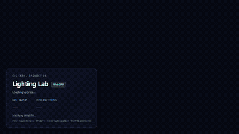

## Contents

- [Run locally](#run-locally)
- [Renderers](#renderers)
- [Performance experiments](#performance-experiments)
- [Optimization studies](#optimization-studies)
- [Correctness and debug views](#correctness-and-debug-views)
- [Limits and next steps](#limits-and-next-steps)
- [Credits](#credits)

## Run locally

The CI workflow uses Node.js 22. A browser with hardware WebGPU support is required.

```sh
npm ci
npm run dev
```

`npm run typecheck` checks TypeScript. `npm run build` checks types, builds the app, and copies scene assets using a cross-platform Node script.

| Control | Action |
|---|---|
| Hold mouse and move | Look around |
| W / A / S / D | Move through the scene |
| Q / E | Move down / up |
| Shift / Alt | Faster / slower movement |
| Renderer | Naive, Forward+, or clustered deferred |
| Scene | 1 to 5,000 lights, pause/reset, camera and resolution presets |
| Clustering and debug | Grid, index-pool budget, occupancy, slices, material attributes, overflow |
| Effects and optimizations | Bundles, depth prepass, compute lighting, packed G-buffer, compute bloom |
| Measurements | Current case, full light sweep, raw JSON export |

Use **Reset scene** with paused lights for visual comparisons. Changing a cluster debug view while using naive rendering selects Forward+, since naive rendering has no cluster data. Bloom is bypassed in debug views.

## Renderers

### Naive forward

The baseline draws the scene directly, sampling each material and testing every active point light for every shaded fragment. Its camera matrix is uploaded through an aligned uniform buffer. Alpha-cutout texels discard before lighting, and light attenuation reaches zero outside a finite radius of two world units.

This is the reference for checking the other renderers. It tests every light even when most are too far away to contribute. Depth testing can skip hidden fragments, depending on draw order and visibility.

### Forward+ and shared clustering

The default camera frustum contains **16 × 12 × 24 = 4,608 clusters**. Screen-space tiles are uniform in X/Y; positive view-space depth is split logarithmically between 0.1 and 1,000:

$$d_i = n\left(\frac{f}{n}\right)^{i/N_z}, \qquad z(d) = \left\lfloor N_z\frac{\log(d/n)}{\log(f/n)}\right\rfloor.$$

The compute shader unprojects each cluster's corners, constructs a conservative view-space AABB, and tests light spheres against it. A small bound expansion protects shared boundaries from rounding. The fragment and compute lighting paths use the same cluster-index and shading functions.

Light lists use an eight-byte `(offset, count)` record per cluster and a shared index pool. Each cluster counts intersections, reserves a contiguous range with one atomic allocation, then writes matching light indices in ascending order. Consumers access storage directly rather than copying a large cluster structure into shader-local memory.

The default pool holds **1,179,648 indices**, an average budget of 256 per cluster. Individual clusters can use more than a thousand entries by sharing that pool. If it runs out, affected clusters test all lights. This preserves the image but slows down shading. Allocation order determines which clusters need the fallback.

### Clustered deferred

The geometry pass writes the closest alpha-tested surface into a G-buffer. A fullscreen triangle or an 8 × 8 compute dispatch then shades valid pixels using the shared clustered-light function. Background pixels are skipped. Compute replaces the deferred **lighting** pass; a common fullscreen composite still presents the HDR result to the canvas.

| Attachment | Baseline | Packed | Purpose |
|---|---|---|---|
| Position | `rgba32float`, 16 B/pixel | Reconstructed | World position |
| Normal | `rgba16float`, 8 B/pixel | Packed into one `u32` | Surface orientation |
| Albedo | `rgba8unorm`, 4 B/pixel | Packed into one `u32` | Material color |
| Packed color attachment | Unused | `rg32uint`, 8 B/pixel | RGBA8 albedo + two signed 16-bit octahedral normal coordinates |
| Depth | `depth32float`, 4 B/pixel | Same | Visibility and position reconstruction |
| **Geometry total** | **32 B/pixel** | **12 B/pixel** | **62.5% less logical storage** |

The packed path has a single color output, stores eight bytes of material/normal data per pixel, and reconstructs position from depth and the inverse view-projection matrix. Both paths also use the same eight-byte HDR lighting output. Bloom adds two half-resolution HDR textures when enabled. These are format-based storage estimates, not measured driver allocations.

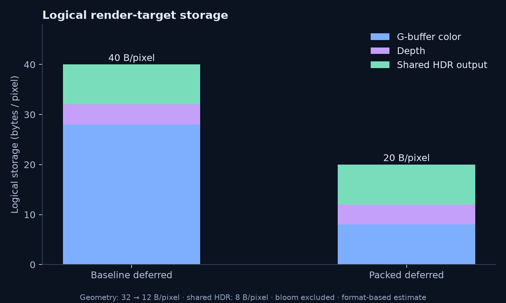

## Performance experiments

### Test conditions

Measurements were captured on **Windows 11, AMD Ryzen 7 8845HS, 15.3 GiB usable RAM, Radeon 780M**, using hardware WebGPU in **headless Chrome 155.0.8059.84**. The machine also has an RTX 4050 Laptop GPU, but **Chrome selected the AMD adapter**; these are not NVIDIA measurements. Exact browser, OS and driver details are saved with the [environment record](docs/benchmarks/environment.json) and raw exports.

The main renderer sweep uses a fixed 960 × 540 render target, Atrium camera, default cluster grid, deterministic light-color seed 5650, and frozen light animation at 0 ms. Each of three repetitions discards 30 warmup frames and records 90 frames per case. Renderer order rotates between repetitions. Optimizations use repeated trials with their own settings recorded in the exports; resolution/camera/grid studies use 60 sampled frames per repetition.

GPU results sum pass-level timestamps, including clustering, lighting/geometry, the shared HDR composite, and enabled effects. They exclude the separate light-animation submission, browser compositor/presentation and readback. CPU results measure renderer command encoding and submit, excluding camera/light updates and asynchronous readback. Three readback slots bound GPU work in flight. Timestamp-disabled devices report CPU-only measurements instead of substituting CPU time for GPU time.

Graphs use **milliseconds**. Error bars show standard deviation between repetition means. These results come from one machine, and power, temperature and browser behavior can affect them. Timestamp quantization also limits measurements of very short passes.

Independent baseline trials showed drift: the same 2,000-light deferred case averaged 8.34 ms in the renderer sweep and 5.54 ms in the later resolution study. Power and thermal state were not locked or logged. Optimization conclusions therefore use a separate **paired, rotating-order study** with three repetitions per setting, rather than comparing unrelated runs. The main/workload sweeps used the development server; paired optimization trials used the production build preview. Compare configurations within each study.

### Renderer scaling

Mean GPU pass time ± standard deviation between three repetition means:

| Point lights | Naive (ms) | Forward+ (ms) | Clustered deferred (ms) |
|---:|---:|---:|---:|
| 100 | 7.34 ± 0.25 | 4.52 ± 0.05 | 4.07 ± 0.09 |
| 500 | 25.01 ± 0.53 | 7.57 ± 1.08 | 5.07 ± 0.13 |
| 1,000 | 51.24 ± 0.68 | 10.40 ± 2.12 | 5.31 ± 0.02 |
| 2,000 | 106.22 ± 0.70 | 16.10 ± 0.12 | 8.34 ± 1.41 |
| 5,000 | 274.50 ± 6.22 | 38.81 ± 4.15 | 16.03 ± 0.45 |

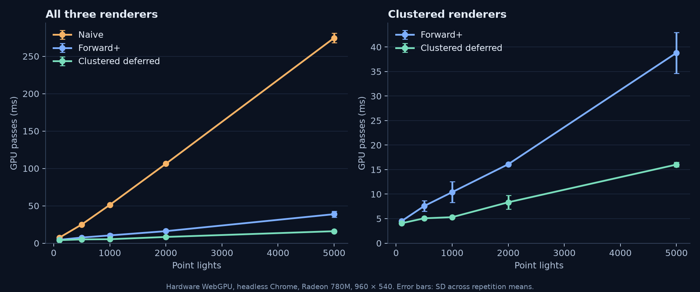

Naive rendering scales approximately with light count, reaching 274.50 ms at 5,000 lights. At that workload, Forward+ is 7.07× faster and baseline clustered deferred is 17.13× faster than naive. Deferred averages 2.42× faster than Forward+ in this case. These ratios use means from this sweep, with all optional effects and optimizations disabled.

Deferred had the lower mean at every tested light count, although the gap is small at 100 lights. At 5,000 lights it spends 1.77 ms on clustering, 7.56 ms on G-buffer geometry, 6.30 ms on lighting and 0.39 ms on the composite. Forward+ spends 35.13 ms on combined geometry and lighting. Separating lighting from geometry appears to help most when there are many lights in this scene.

Deferred writes more data during the geometry pass, then lights only the visible surface at each pixel. Forward+ avoids those G-buffer transfers, but can light fragments that closer geometry later replaces. The tradeoff depends on resolution, light occupancy, draw order and visibility. These tests measure pass times; they do not measure bandwidth or count overdraw directly.

### Workload sensitivity

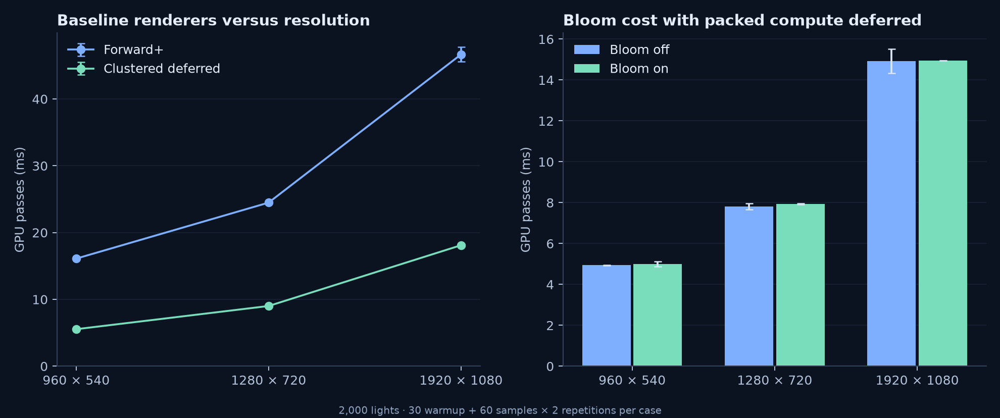

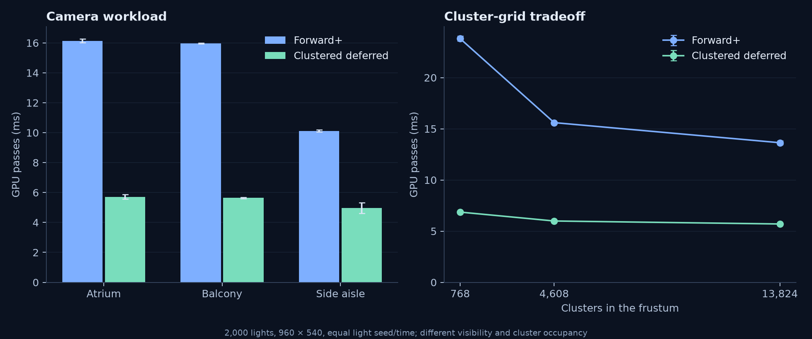

At 2,000 lights, increasing resolution from 960 × 540 to 1920 × 1080 quadruples the pixels and raises Forward+ time from 16.10 to 46.67 ms; deferred rises from 5.54 to 18.11 ms in this resolution study. Both therefore have substantial per-pixel cost. Clustering does not acquire more clusters when resolution changes, so its basic light/cluster workload stays fixed.

The side-aisle camera is cheaper than Atrium: 10.12 versus 16.14 ms for Forward+, and 4.97 versus 5.71 ms for deferred. Mean full-frustum occupancy also drops from 66.91 to 37.99. Different geometry visibility and light overlap plausibly explain this, but no isolated overdraw counter was captured.

Increasing the grid from 768 to 13,824 clusters lowers Forward+ from 23.81 to 13.64 ms and deferred from 6.86 to 5.70 ms. Mean occupancy falls from 91.76 to 57.64, while list storage increases from 792,592 to 14,266,384 bytes. The fine grid helps these cases, with diminishing benefit for deferred. It is not a free improvement: more cluster work and storage can outweigh smaller lists in another workload.

Cluster statistics describe the full frustum grid, including clusters without visible geometry. Their mean occupancy is useful for understanding list storage and culling conservatism, but it is not the average number of lights shaded by a visible pixel.

## Optimization studies

### 1. Variable-length light lists

The first implementation stored 128 indices per cluster and correctly fell back to all-light shading on overflow. That was robust but costly: at 5,000 lights, 2,376 clusters exceeded the cap, even though mean occupancy across the grid was only 167.36. A variable-length pool lets lightly populated clusters share their unused storage with dense clusters.

At that same frozen scene, the pool stores 771,193 indices with zero overflow. The change increased default list storage from 2,377,728 to 4,755,472 bytes and added a second intersection sweep, while removing most fallback shading work.

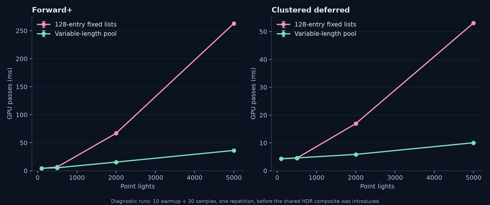

The before/after data above are **short diagnostic runs**: 10 warmup frames, 30 samples, one repetition, before the shared HDR composite was added. They show the bottleneck that motivated the change; the longer renderer sweep describes the final implementation. At 5,000 lights, these diagnostic GPU means changed from 262.95 to 36.26 ms for Forward+ and 53.08 to 10.04 ms for deferred. Clustering itself became more expensive, illustrating why pass breakdowns matter.

The pool helps most when dense clusters would overflow fixed lists. With sparse lights, the extra intersection sweep and allocation can cost more than they save. Transforming lights to view space once per frame, caching cluster bounds until the projection changes, or allocating lists with a prefix sum could reduce that overhead.

### 2. Compute lighting and packed G-buffer

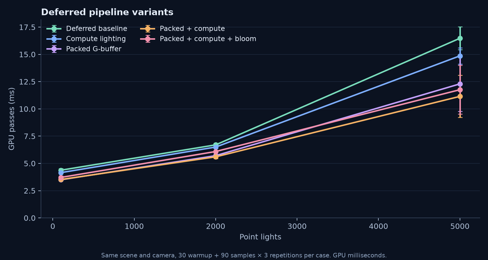

The paired 2,000-light study measures 6.70 ms for baseline deferred, 6.50 ms for compute lighting alone, 5.71 ms for packing alone and 5.60 ms for packing plus compute. At 5,000 lights, those means are 16.48, 14.86, 12.29 and 11.15 ms, respectively. The combined mean is 32.3% below baseline at 5,000 lights, but its between-repetition SD is 1.94 ms; the exact gain is sensitive to the run conditions.

The 5,000-light pass breakdown helps locate the change:

| GPU pass | Baseline deferred (ms) | Packed + compute (ms) |
|---|---:|---:|
| Light clustering | 1.41 | 1.36 |
| G-buffer geometry | 7.76 | 4.17 |
| Lighting | 6.62 | 5.16 |
| Composite | 0.69 | 0.45 |
| **Total** | **16.48** | **11.15** |

Most of the savings are in geometry and lighting, where packing reduces the data written and read. Bandwidth was not measured directly. Compute alone gives a smaller improvement, and its 100-light difference falls within the observed variation. Packing accounts for most of the combined improvement.

Compute lighting uses the same shading equation and decoded inputs as the fullscreen pass. Its performance depends on occupancy, register use and memory access. Packing saves memory traffic but adds normal decoding, depth reconstruction and quantization. It should help most when G-buffer traffic is expensive; that extra decoding work can matter more in lighter workloads.

### 3. Render bundles and depth prepass

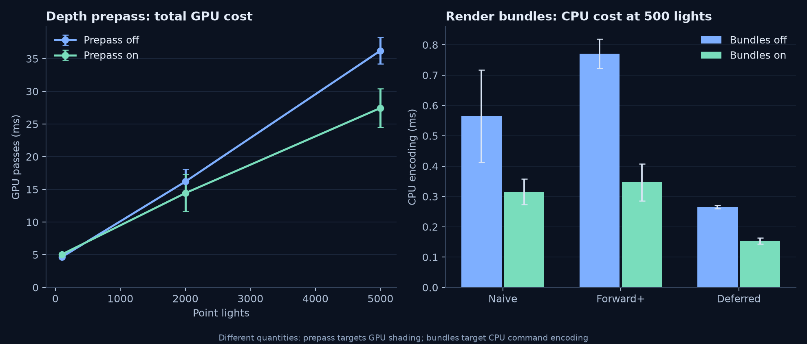

At 5,000 lights the paired prepass study changes Forward+ from 36.23 ± 2.00 to 27.45 ± 2.95 ms, including the prepass: a 24.2% reduction in the mean. Shading falls from 33.97 to 21.58 ms while the prepass costs 3.51 ms. At 100 lights the total instead rises from 4.65 to 5.06 ms. The 2,000-light trials have overlapping variability, so these measurements do not precisely locate the crossover.

At 500 lights, bundles reduce mean CPU encoding as follows:

| Renderer | Bundles off (ms) | Bundles on (ms) | CPU speedup |
|---|---:|---:|---:|
| Naive | 0.565 | 0.316 | 1.79× |
| Forward+ | 0.771 | 0.347 | 2.22× |
| Clustered deferred | 0.265 | 0.153 | 1.74× |

GPU means remain much closer than the CPU changes, and their variation does not show a consistent large GPU benefit. The absolute CPU savings are below half a millisecond here; they should not be interpreted as the same reduction in displayed frame time when the GPU is the bottleneck.

Bundles record the static scene's geometry commands once per pipeline, saving CPU work on later frames. The GPU still executes those draws. They are most useful with many static draws and a CPU bottleneck. A small scene has less encoding work to save, while a changing draw list may require frequent re-recording. Draw-call count was fixed in these tests.

The prepass performs the same material alpha test as final shading. The lighting pass then uses equal-depth testing with depth writes disabled. Stencil keeps the first fragment when surfaces have the same depth, preserving the baseline's draw order and avoiding repeated lighting at those ties. This helps when overdraw and lighting are expensive. With few lights, the extra geometry pass, alpha sampling and stencil traffic can cost more than they save. **Depth-based active-cluster culling is not implemented.**

### 4. Compute bloom

Bloom starts from the unclamped HDR scene. A compute pass averages 2 × 2 pixels and extracts color above a threshold. Two half-resolution compute passes apply a normalized separable Gaussian blur with radius five and sigma two; the composite adds the blurred result back. Defaults are threshold 0.8 and strength 0.2.

| Bloom off | Compute bloom on |
|---|---|
| 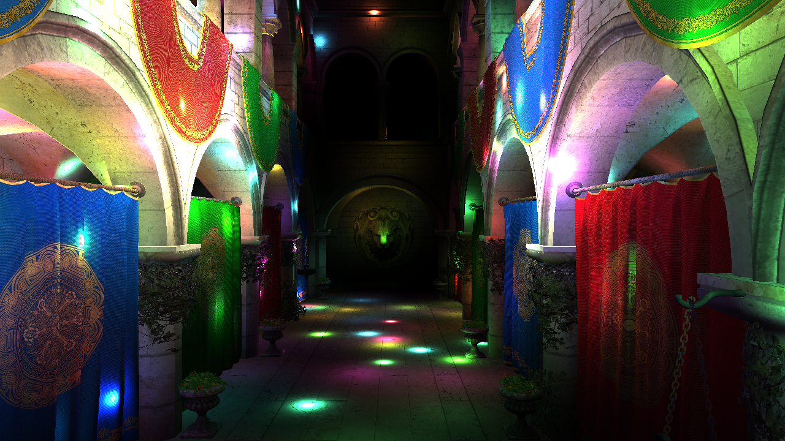 |  |

In the resolution study at 2,000 lights, the three timestamped bloom compute passes together cost **0.123 ms at 960 × 540, 0.221 ms at 1280 × 720, and 0.486 ms at 1920 × 1080**. Their cost grows with pixel count. Total on/off frame differences are smaller and less stable because other passes vary too; the 1080p total difference is only 0.03 ms despite approximately 0.49 ms of measured bloom-pass work. Use the pass-level measurements to understand that effect rather than attributing the entire total-time difference to bloom.

The paired 960 × 540 / 2,000-light study changes packed compute deferred from 5.60 to 6.09 ms with bloom. At 5,000 lights, wider variation makes the 11.15 versus 11.76 ms totals less precise. Bloom is an intentional visual cost, while its half-resolution separable implementation limits the work.

Strength and threshold change the appearance without changing the number of passes or samples. Their timing was not tested separately. For wider glows, a mip-chain bloom would be worth comparing against a larger blur radius, though it would add stages and change the appearance.

## Correctness and debug views

| Occupancy | Depth slices |
|---|---|
| 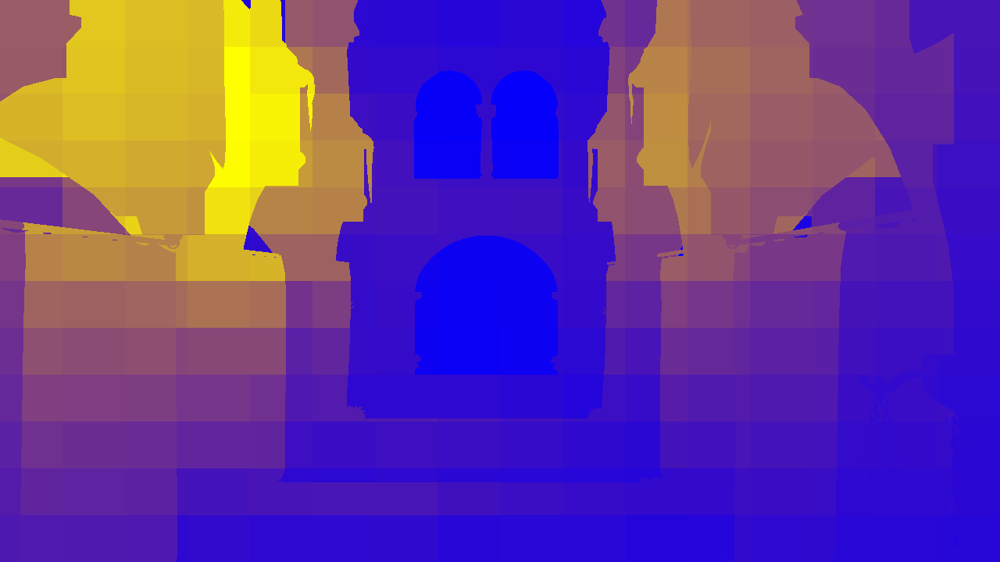 |  |

Occupancy runs from blue to yellow over 0 to 512 lights; empty clusters are black. Magenta marks clusters using the exhausted-pool fallback.

| Albedo | Normals | World position |
|---|---|---|
| 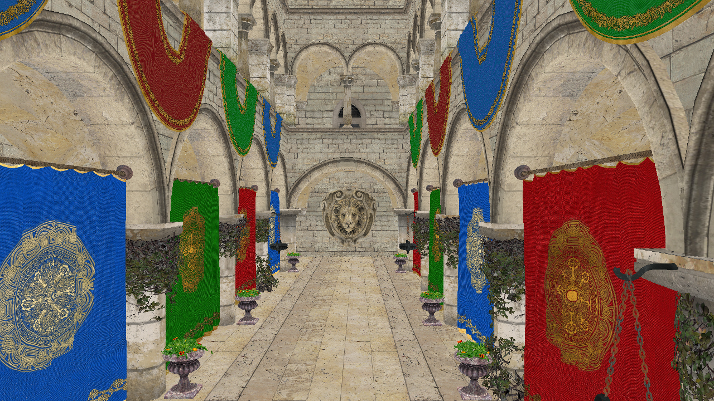 | 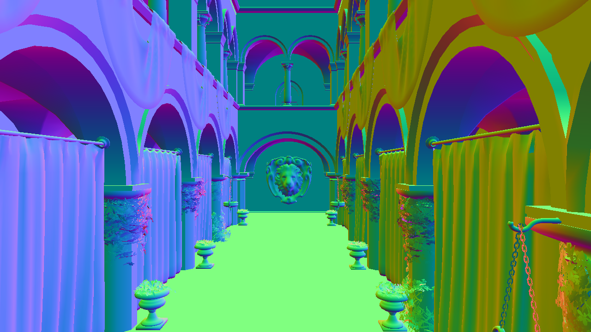 | 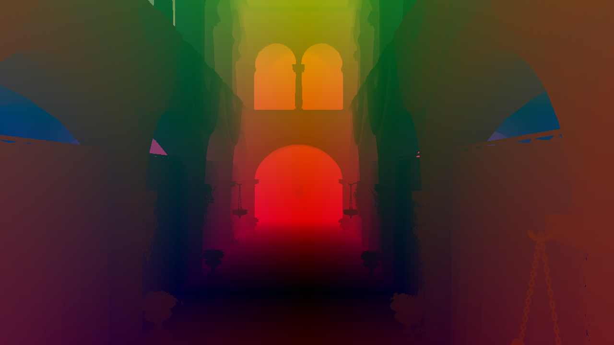 |

Frozen comparisons exclude UI overlays and compare the same light state/camera. Forward+ matched naive pixel-for-pixel at 1, 500 and 5,000 lights, and in additional camera/grid checks. Intentionally shrinking the pool to 64 indices per cluster on average forced overflow while preserving the Forward+ image exactly. Render bundles and the corrected depth prepass also preserved their reference images exactly in the tested cases.

Deferred G-buffer storage introduces measurable error. At 960 × 540 and 5,000 lights, baseline deferred versus naive had mean RGB absolute error **0.19854 on a 0 to 255 scale**, with a maximum channel difference of 42 near bright lights. At 833 × 469 and 2,000 lights, packed versus baseline deferred had mean error **0.02360**, maximum 12, and 28 pixels with a channel difference above three. The tests use different references and workloads, so their error values should be read separately. Raster and compute lighting were pixel-identical in both G-buffer modes for that test.

Checks also cover non-workgroup-multiple resolutions, resizing with packed compute/bloom enabled, renderer switching, numeric GUI options, timestamp-query fallback and benchmark cancellation. [Raw correctness records](docs/benchmarks/extensions-validation.json) and the [implementation log](docs/implementation-log.md) describe scope and tolerances.

## Reproduce the analysis

Select a camera, fixed render resolution and settings in the UI, then run **Benchmark current** or **Full light sweep**. Export the raw JSON afterward. Camera input, light motion and debug views are suspended during sampling; scene controls are restored afterward. A cancellation button is available.

The same application instance exposes a console API:

```js
await lightingLab.runBenchmark({
  lightCounts: [100, 500, 1000, 2000, 5000],
  warmup: 30,
  samples: 90,
  repeats: 3,
});
// Then use Export last results in the Measurements folder.
```

Use `?timestamps=off` to verify CPU-only fallback. Raw exports retain settings, camera pose, adapter/browser details, individual frames, pass timings, repetition summaries, and cluster histograms. [summary.csv](docs/benchmarks/summary.csv) contains one row per final measured run.

To regenerate figures from the committed datasets:

```sh
python -m pip install matplotlib
python scripts/plot_benchmarks.py
```

## Limits and next steps

- The scene uses alpha cutouts; blended transparency is not implemented. Forward rendering can support it more directly in a broader renderer, but that capability is not demonstrated here.
- Clustering counts all lights against every cluster, then repeats the intersection test for nonempty lists that fit in the pool. A finer grid can reduce shading while increasing clustering cost and storage.
- Shared pool allocation has atomic contention; exhaustion preserves correctness but makes performance less predictable.
- Packed positions depend on finite-precision depth reconstruction, and albedo/normals are quantized. This is a measured quality/memory tradeoff.
- The common composite clamps HDR output to the canvas; this project does not add a filmic tone mapper, shadows, PBR materials, SSAO or a visibility buffer.
- Results cover one supplied scene and the selected AMD adapter. Camera changes vary the workload but are not a controlled synthetic overdraw experiment.
- Active-cluster culling, view-space light preprocessing and a second GPU/browser comparison are useful future studies.

## Deployment and submission

The [deployment workflow](.github/workflows/static.yml) builds the app and publishes `dist` when changes reach `main`. It sets the repository URL prefix and copies the scene assets during the build.

1. In the fork's **Settings**, open **Pages**. Under **Build and deployment**, choose **GitHub Actions** as the source. The workflow is already included, so there is no need to create another one.
2. Open the **Actions** tab and enable workflows if GitHub asks.
3. Push the implementation branch:

   ```sh
   git push -u origin codex/lighting-lab
   ```

4. Open a pull request in this fork with `main` as the base and `codex/lighting-lab` as the compare branch, then merge it. This is separate from the course submission PR.
5. In **Actions**, wait for **Deploy static content to Pages** to finish. If the code was already on `main` before Pages was enabled, open that workflow and use **Run workflow** on `main`.
6. Open the [public demo](https://farisyahz.github.io/Project4-WebGPU-Forward-Plus-and-Clustered-Deferred/). Check that Sponza loads and the renderer controls work, then update the publication note at the top of this README.

Submit the course PR with the title **Project 4: Faris Rafie Syahzani**. The [submission description](docs/submission.md) is ready to use.

## Credits

- [CIS5650 Fall 2026 starter project](https://github.com/CIS5650-Fall-2026/Project4-WebGPU-Forward-Plus-and-Clustered-Deferred): scene assets, glTF loading, input controls, light animation, starter renderer structure and dependencies.
- [Vite](https://vite.dev/), [loaders.gl](https://loaders.gl/), [dat.GUI](https://github.com/dataarts/dat.gui), [stats.js](https://github.com/mrdoob/stats.js), and [wgpu-matrix](https://github.com/greggman/wgpu-matrix): existing application dependencies.
- The starter's Perlin noise implementation credits [Stefan Gustavson and Munrocket](https://gist.github.com/munrocket/236ed5ba7e409b8bdf1ff6eca5dcdc39), MIT license; that attribution is retained in the shader.
- [WebGPU specification](https://www.w3.org/TR/webgpu/) and [WGSL specification](https://www.w3.org/TR/WGSL/): binding/layout rules, timestamp queries and packing builtins. [wgpu-matrix documentation](https://wgpu-matrix.org/docs/) documents WebGPU's 0 to 1 clip-depth convention.
- Matplotlib generated the original benchmark figures; Playwright/Chrome were used as development validation tools, and FFmpeg encoded the original captured demo. These tools are not bundled into the renderer.
- [Logan Dooley's project README](https://github.com/LoganDooley/Project4-WebGPU-Forward-Plus-and-Clustered-Deferred) was a reference for presenting the project. The implementation, writing, screenshots and measurements here are original.
